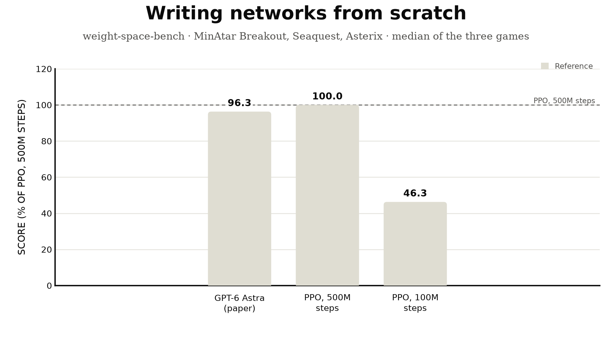

## Leaderboard: writing MinAtar networks from scratch

Score = median over the three games of the normalized score (0 = random play, 100 = the best PPO network trained for 500M steps). Raw = mean game score over 3 attempts x 1000 episodes.

| # | model | lab | score | Breakout (raw / % PPO) | Seaquest (raw / % PPO) | Asterix (raw / % PPO) | effort | API cost | tokens in / out per reply |
|---|---|---|---|---|---|---|---|---|---|
| | *GPT-6 Astra (paper)* | reference | *96.3* | 517.4 / 2084% | 53.1 / 60% | 53.2 / 96% | | | |
| | *PPO, 500M steps* | reference | *100.0* | 25.3 / 100% | 88.9 / 100% | 55.2 / 100% | | | |
| | *PPO, 100M steps* | reference | *46.3* | 15.8 / 61% | 5.6 / 6% | 25.8 / 46% | | | |
| | *random play* | reference | *0.0* | 0.54 / 0% | 0.09 / 0% | 0.50 / 0% | | | |

